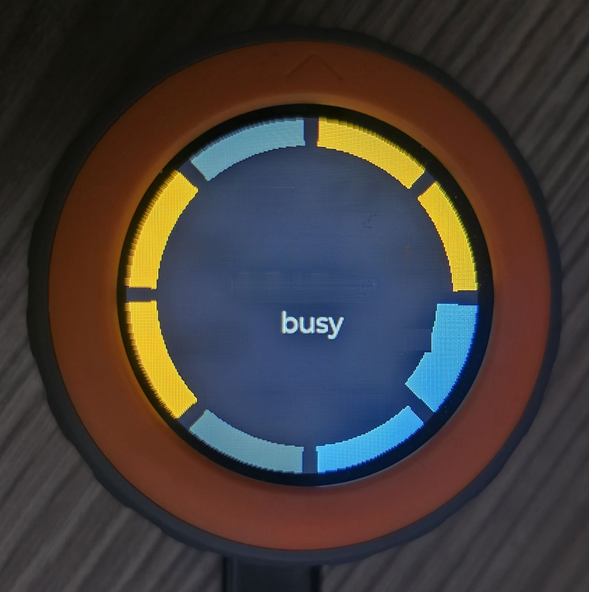

# M5Stack Dial · Claude Code session monitor



A physical desk notifier for your **Claude Code sessions**, built on an **M5Stack Dial v1.1**
(MicroPython on the UIFlow2 firmware). Every running session is a colored segment on the
Dial's round display, so one glance tells you which sessions are working, which have
finished and which are **waiting for you**. Turn the knob to select a session, press it,
and your PC jumps to the matching **Warp** tab. When you lock the PC, the Dial locks too
and shows only the clock and the weather.

Highlights:

- a ring with one segment per session, colored by state (working, sub-agents running, idle, waiting for you, blocked on a permission)
- optional beep when a session starts waiting; per-session mute; global volume on touch
- jump to the session's Warp tab with a click, or by dwelling 2 s after turning the knob
- the Dial follows the active Warp tab when you switch tabs on the PC
- idle panel with clock, date, weather and a summary; locked-PC view with no work information
- a launcher, so the device can hold more than one app

**[Full tour with photos and design notes: docs/SHOWCASE.md](docs/SHOWCASE.md)**

The code is developed on the PC and pushed with `mpremote`, bypassing the cloud web IDE.
Detailed hardware and API reference: **[`docs/M5DIAL-reference.md`](docs/M5DIAL-reference.md)**
(workflow notes: [`docs/M5DIAL-development-workflow.md`](docs/M5DIAL-development-workflow.md)).

## Hardware

- **M5Stack Dial v1.1** (ESP32-S3, 1.28" round touch display, rotary encoder with button)
- a USB-C cable (power and data)
- a PC running Windows with Python 3.12; the [Warp](https://www.warp.dev/) terminal is needed only for tab jumping
- optional: a 3D-printed stand (see below)

## Quick start

```powershell
# 1. one-time: PC-side tools
pip install mpremote esptool m5stack-stubs

# 2. one-time: editor completion (typings/ is not version controlled)
.\tools\fetch-typings.ps1

# 3. daily loop
.\tools\push.ps1 -List      # which COM port is the device on?
.\tools\push.ps1 -Run       # run without saving, print() goes to the console
.\tools\push.ps1 -Deploy    # write to /flash/main.py + reset
.\tools\push.ps1 -Repl      # interactive REPL (exit: Ctrl-])
```

No driver is needed: the Dial uses the native ESP32-S3 USB-CDC, which Windows recognizes
with the built-in `usbser.sys`.

To set up the session monitor itself (firmware check, uploading the app, wiring the Claude
Code hooks, starting the PC agent), follow section 4 of [docs/SHOWCASE.md](docs/SHOWCASE.md).

## Layout

| Path | What it is |
|------|------------|
| `src/main.py` | the program that goes on the device (encoder + button + touch demo) |
| `src/apps/session_monitor.py` | the Claude session monitor app ([showcase](docs/SHOWCASE.md)) |
| `tools/session_agent/` | the PC-side agent (processes, weather, lock state, serial port) |
| `docs/M5DIAL-reference.md` | hardware, pin map and API reference |
| `tools/push.ps1` | dev loop: run / deploy / REPL |
| `tools/fetch-typings.ps1` | generates the `typings/` folder from the upstream repo |
| `typings/` | *(not version controlled)* UIFlow2 libraries for the editor |
| `pyrightconfig.json` | pyright/Pylance settings for MicroPython idioms |

## Verification

```powershell
python -m unittest discover -s tests   # the pure logic (no hardware needed)
npx pyright                            # 0 errors
```

The import warnings for `machine` / `micropython` / `uselect` are expected: those modules
exist only on the device.

## 3D-printed stand

The Dial sits in a 3D-printed stand, display facing the user
([photo](docs/images/06-3d-printed-stand.jpg)).

- **Model:** [M5Stack Dial Rotary Knob Stand](https://makerworld.com/hu/models/763395-m5stack-dial-rotary-knob-stand#profileId-782177) (MakerWorld)
- **Printing:** ordered through [3dkraft.hu](https://3dkraft.hu/), roughly 3,500 HUF

## License

[MIT](LICENSE)
