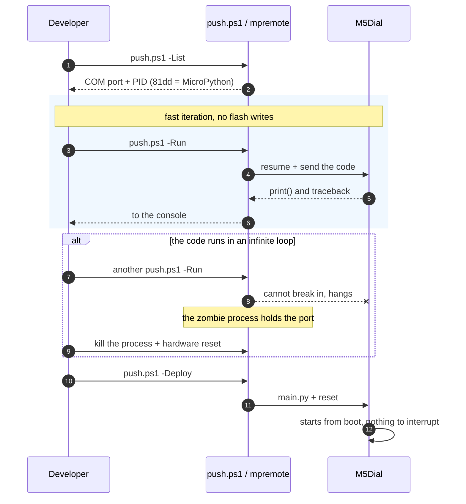

# M5Dial development workflow

> This process comes from **measured experience** in a real working session
> (2026-09-09), not from theory. Behind every "why" is a concrete failure we hit
> that day.
> Hardware and API reference: [`M5DIAL-reference.md`](M5DIAL-reference.md).

## 1. What is this?

A repeatable process for MicroPython development on the M5Stack Dial v1.1 with
UIFlow2 firmware, without the cloud IDE. It describes **the order** to work in and
where the traps are that silently mislead you.

The key lesson up front: **on this device it is very easy to believe your code is
running when it never started.** Most of this workflow guards against that.

## 2. How to use it

### 2.1 Start of a session — always begin with this

```powershell
.\tools\push.ps1 -List      # which COM port is it on, and is it there at all
```

If nothing is found: the device is not plugged in, or the factory (Arduino)
firmware is running. The USB PID tells the two apart:

| PID | Meaning |
|---|---|
| `303a:81dd` | UIFlow2 MicroPython is running — all good |
| `303a:1001` | ESP32-S3 hardware USB-Serial/JTAG → **not MicroPython**, firmware needed |
| no port | not plugged in |

**The port number changes** after a firmware write (for us COM3 → COM4), because
on native USB the device re-enumerates. Do not hard-code the port number anywhere.

### 2.2 The development loop

```powershell
.\tools\push.ps1 -Run       # run without flash writes, print() to the console
.\tools\push.ps1 -Deploy    # /flash/main.py + reset (make it permanent)
.\tools\push.ps1 -Repl      # REPL, exit: Ctrl-]
.\tools\push.ps1 -Ls        # the device's file system
```

### 2.3 Verify before calling anything "done"

```powershell
python -m unittest discover -s tests    # the pure logic
npx pyright                             # 0 errors (`machine`/`lvgl` warnings are fine)
```

These **do not replace** running on the device. They test the pure logic, not the
drawing, the input or the sound.

## 3. How does it work? — the flow



## 4. Technical details — the traps

### 4.1 The most important one: a running app cannot be reliably interrupted

If an app with a `while True` loop is running on the board, `mpremote` **hangs
silently**. It dies on a timeout, but the **zombie process keeps holding the COM
port**, and from then on every further command fails with `PermissionError` — even
`esptool`.

The danger is not the error but that **it does not look like an error**: the output
is empty, the command "completes", and you think your new code is running. We got
as far as believing two fixes worked when they had never even started.

**Rule: if a `-Run` gives empty output, do NOT treat it as success.** Clean up first:

```powershell
# your own stuck mpremote processes
Get-CimInstance Win32_Process -Filter "Name='python.exe'" |
  Where-Object { $_.CommandLine -match 'mpremote' } |
  ForEach-Object { Stop-Process -Id $_.ProcessId -Force }

# hardware reset (does not write flash, only restarts)
esptool --port COMx --after hard-reset flash-id
```

**When testing a launcher or a long-running app, do not try it with `-Run`.**
Install it as `main.py` and start it from boot — then there is nothing to interrupt.

### 4.1.1 Capturing the boot output

If you test from boot with the app installed as `main.py`, `mpremote` cannot attach —
you have to read your `print()` output straight from the serial port. The trap is
timing: on native USB the reset **re-enumerates** the device, the old port handle is
dead, and by the time you open it 2.5 s later the boot output **is already gone**.
That is how our log ended up empty.

Recipe: after the reset, **try opening the port every 100 ms** (it opens at about
500 ms), and **reopen it** during a soft reset:

```powershell
mpremote connect COM4 resume exec "import machine; machine.reset()"
foreach ($i in 1..60) {
  Start-Sleep -Milliseconds 100
  try { $sp = New-Object System.IO.Ports.SerialPort 'COM4',115200,'None',8,'One'
        $sp.DtrEnable = $true; $sp.Open(); break } catch { $sp = $null }
}
$end = (Get-Date).AddSeconds(10)
while ((Get-Date) -lt $end) { $sp.ReadExisting(); Start-Sleep -Milliseconds 100 }
```

For a longer, interactive trial (someone turning and pressing the knob), do the same
logged to a file in a background process that reopens the port — the port vanishes
during a soft/hard reset and the logger has to survive that. **While it runs it
holds the port**: `mpremote` will report `failed to access COM4` in the meantime.

### 4.2 It does not work without `resume`

A plain `mpremote run` soft-resets first, which restarts the factory launcher, and
its WiFi connection can **hold the REPL for up to 60 seconds** → `could not enter raw
repl`, every time. That is why `push.ps1` uses `resume` everywhere; if you call
`mpremote` by hand, you need it too.

### 4.3 The app overwrites the launcher's state

Two concrete, measured collisions:

- **`M5.begin()` in the app clears previously registered button handlers.** So the
  launcher's "back" gesture must not rely on an M5 callback — it disappears when the
  app starts. A hardware-level path is needed instead (`machine.Timer` + reading
  the pin).
- **Two simultaneous `Rotary()` instances paralyze the encoder** (the counter stays
  at 0). Call `rotary.close()` before starting.

In general: **the app and the launcher share the same hardware.** Whatever the
launcher claims, it must release before handing over control.

### 4.3.1 You cannot reset from a callback

`machine.soft_reset()` works by raising a **`SystemExit` exception**. If you call it
from a callback — an M5 button handler or a `machine.Timer` — the callback frame
**swallows the exception** and the reset does not happen. Measured: on every click
this was the only thing sent to the serial port:

```
Traceback (most recent call last):
  File "main.py", line 148, in btnA_wasReleased_event
SystemExit:
```

From the outside this looks like "the menu beeps but the app does not start" —
another silent misdirection. Two correct patterns:

- **you have your own main loop** (the launcher's list): the callback only *sets a
  flag*, and the main loop calls `soft_reset()`, outside any callback;
- **you have no main loop** (a foreign app is running and you only watch from a
  timer): `machine.reset()` — a hardware reset that does not use an exception and
  works from anywhere. Cost: USB re-enumerates and the serial port briefly vanishes.

### 4.4 Measure, don't guess

Debugging sped up when we measured instead of assuming. Two examples:

- "The button is GPIO42" — the first measurement read `1` throughout, because the
  button was not being pressed at that moment. In the **second measurement we logged
  M5's `BtnA.isPressed()` and the raw pin at the same time**, and it became clear:
  GPIO42, active low, and a 2723 ms hold showed up cleanly.
- "`Rotary()` clamps to 0..10" — an earlier version of the reference claimed this,
  and it was **wrong**. The source (`typings/driver/rotary/rotary.py:154`) showed
  that `hardware.Rotary` hard-codes `RANGE_UNBOUNDED`.

**`typings/` is the ground truth.** If you are unsure of an API name, grep for it
instead of writing it from memory:

```powershell
Select-String -Path typings -Include *.py -Recurse -Pattern 'class M5Arc' -Context 0,30
```

If the device is at hand, even better — ask it:

```powershell
mpremote connect COMx resume exec "import startup.dial.apps.app_list as m; print(dir(m))"
```

That is how we found out that the class is called `ListApp` in the release, not
`AppList` as on the repo's master branch.

### 4.5 Do not trust the factory launcher

The Dial's `Framework.run()` loop **handles only touch, rotation (for page
switching) and a CardKB keyboard — not the button**. The factory `ListApp` code is
in the firmware and can be wired up, but without a button it cannot launch an app.
That is why we built our own launcher (`src/launcher.py`).

### 4.6 File handling

Files in this repo are **UTF-8 without BOM, CRLF**. And a fresh
lesson: Python's `.replace()` **fails silently on a CRLF file** if you write the
multi-line block you are searching for with LF. After a multi-line replacement,
**always check with grep** that it actually went in — otherwise you report a
"successful" update that never happened.

### 4.7 Firmware

Only after a separate confirmation, because it overwrites what is on the board:

```powershell
esptool --chip esp32s3 --port COMx write-flash 0x0 uiflow-...-dial-v2.5.2-...bin
```

A single merged image, offset `0x0`. Afterwards verify: the PID switches to `81dd`.

### 4.8 Startup behavior

The NVS `boot_option` decides what runs at power-on:

| value | behavior |
|---|---|
| `0` | `/flash/main.py` directly |
| `1` | factory launcher menu (default) |
| `2` | network connection only |

```powershell
mpremote connect COMx resume exec "import esp32; n=esp32.NVS('uiflow'); n.set_u8('boot_option',0); n.commit()"
```

This writes the device's state — do it only with the device owner's permission.

## 5. Checklist

Before reporting anything as done:

- [ ] `python -m unittest discover -s tests` — green
- [ ] `npx pyright` — 0 errors
- [ ] The code **actually ran on the device**, and you saw its serial output
- [ ] If the output was empty: you cleaned up, reset, and **tried again**
- [ ] For anything visible only on the display (drawing, sound, input), you asked for
      **confirmation from someone looking at the device** — do not claim that
      something works if you did not see it
- [ ] Your project notes are updated, including what did **not** work

## 6. Tech stack

- **Device**: M5Stack Dial v1.1 (ESP32-S3-FN8, 8 MB flash, no PSRAM)
- **Firmware**: UIFlow2 v2.5.2 (MicroPython 1.27.0, M5Unified/M5GFX, LVGL)
- **PC**: Python 3.12, `mpremote` 1.29, `esptool` 5.4, PowerShell 7
- **Editor support**: `typings/` from the upstream repo (`tools/fetch-typings.ps1`),
  `pyrightconfig.json`
