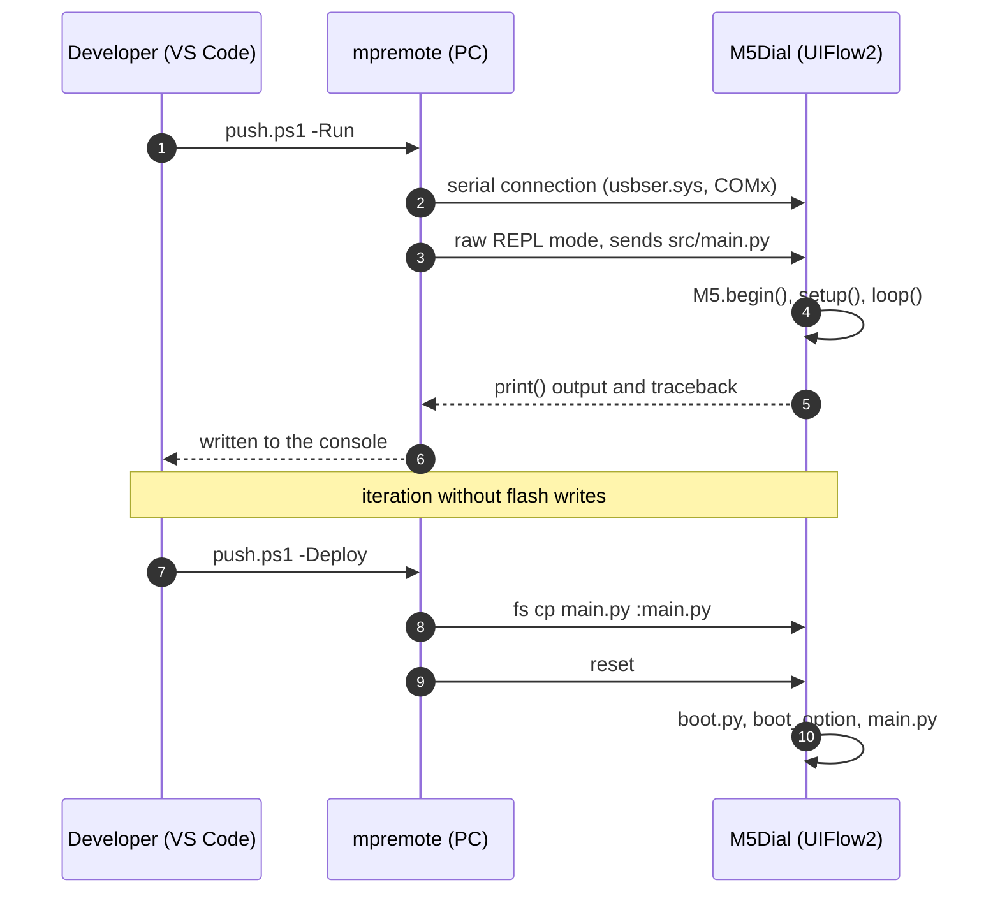

# M5Stack Dial (v1.1) — MicroPython developer reference

> Everything below was verified against a **locally cloned** copy of the
> `m5stack/uiflow-micropython` repo or the official documentation. Where a fact
> could not be confirmed, it is marked explicitly.

## 1. What is this?

The **M5Stack Dial** is an ESP32-S3 based development device with a rotary knob, a
240×240 **round** touch display, a built-in RFID reader, an RTC and a buzzer. It is
programmed in MicroPython on the **UIFlow2 firmware**: an M5Stack-built MicroPython
variant that includes the `M5`, `hardware`, `m5ui` and `unit` modules.

This document is a reference for **cloud-free** development (without the
uiflow2.m5stack.com web IDE): code edited on the PC → `mpremote` → device.

## 2. How to use it

### 2.1 One-time setup

1. **Driver: not needed.** The Dial uses the ESP32-S3's native USB-CDC (VID
   `0x303A`, PID `0x81DD`); Windows recognizes it with the built-in `usbser.sys` as
   "USB Serial Device (COMx)". The CP210x/CH9102 driver is for other M5 devices, not
   this one.
2. **Firmware**: [M5Burner](https://shop.m5stack.com/pages/download) → look for the
   "Dial" UIFlow2 entry. Manually:
   ```powershell
   esptool --chip esp32s3 --port COM5 write_flash 0x0 uiflow-...-dial-v2.5.2-...bin
   ```
   The `.bin` is a single merged image; **`0x0`** is the correct offset.
   Download: <https://github.com/m5stack/uiflow-micropython/releases>
3. **PC tools** (`mpremote` and `esptool`):
   ```powershell
   pip install mpremote esptool m5stack-stubs
   ```

### 2.2 Everyday development loop

```powershell
.\tools\push.ps1 -List      # which COM port is it on?
.\tools\push.ps1 -Run       # run WITHOUT saving, print() goes to the console
.\tools\push.ps1 -Deploy    # write to /flash/main.py + reset (make it permanent)
.\tools\push.ps1 -Repl      # interactive REPL, exit: Ctrl-]
.\tools\push.ps1 -Ls        # the device's file system
```

`-Run` is the fastest: it does not write to flash, runs immediately, and `print()`
output and tracebacks appear in the terminal.



### 2.3 Making your own code start instead of the launcher

The firmware's `/flash/boot.py` reads `boot_option` from NVS:

| value | behavior |
|-------|----------|
| `0`   | **runs `main.py` directly** |
| `1`   | startup menu + network setup (factory default) |
| `2`   | network connection only |

Set it on the device (in the REPL):

```python
import esp32
nvs = esp32.NVS("uiflow")
nvs.set_u8("boot_option", 0)
nvs.commit()
```

Alternative: delete `/flash/boot.py` — then no startup logic runs at all.

### 2.4 Writing an app that starts from your own launcher

With `boot_option = 0`, `/flash/main.py` is our own launcher (`src/launcher.py`),
and the apps are standalone `.py` files in the `/flash/apps/` folder. An app and the
launcher **share the same hardware**, so there is a contract they must follow: who
calls `M5.begin()`, who owns `Timer(0)` and GPIO42, why `time.sleep_ms(10)` is
mandatory in the loop, and why you must not call `soft_reset()` from a callback.

Read this before writing a new app — every point is a measured, painfully learned
failure.

**How an app is actually started.** The click does *not* run the app in place. The
launcher writes the chosen filename into `/flash/.launch` and soft-resets. After the
reboot, `main()` reads the marker, clears it, and `execfile`s the app with
`__name__ == "__main__"` — **before the list is ever drawn**. So the app gets a clean
machine: no launcher widgets, no launcher `Rotary`, no leftover callbacks.

Why the detour: running the app in place failed in the field — its counter sat at 0
forever, because the hardware the launcher had already claimed (encoder interrupts,
M5 state) interfered. The same app run standalone worked perfectly.

**The contract an app must honour:**

| Rule | Why (measured) |
|---|---|
| Call `M5.begin()` yourself | The app owns the hardware; nothing is set up for you. |
| `time.sleep_ms(10)` in every loop iteration | A sleepless tight loop starves the USB-CDC REPL. `mpremote` can no longer break in, the zombie holds the port, and **the host serial driver wedges — only a physical replug clears it**. The stock framework uses `await asyncio.sleep_ms(10)` for exactly this reason. |
| One `Rotary()` instance, ever | Two live instances freeze the encoder: the counter reads a fixed 0. |
| Leave `Timer(0)` alone | The launcher's "back" watchdog lives there. Take it and long-press stops working. |
| Leave GPIO42 alone | Same watchdog polls it directly. |
| Don't claim long press (~1.5 s) on BtnA | Reserved by the launcher for "back to list". Short click is yours. |
| Never `machine.soft_reset()` from a callback | It raises `SystemExit`, which the M5 callback frame **swallows** — you get a traceback and no reset. Set a flag, reset from the main loop. From a `Timer` callback (no loop of your own) use `machine.reset()`. |
| Never catch `BaseException` | Same cause, worse effect. `machine.soft_reset()` *works by* letting `SystemExit` reach the top level. A well-meant `except BaseException` swallows it, the reset never happens, and the whole chain falls through to the REPL instead. Catch `Exception`; let `SystemExit` pass. |
| If you call `micropython.kbd_intr(-1)`, provide a way back | It also disables Ctrl-C, so `mpremote` can no longer break in: `could not enter raw repl`. Restore it in a `finally` (`kbd_intr(3)`), **and** give the program a remote quit command — otherwise every redeploy needs a human to long-press the knob. |
| Don't rely on registering M5 button callbacks *before* `M5.begin()` | `M5.begin()` wipes previously registered handlers. That is why the launcher's back gesture is a `machine.Timer` polling the pin, not an M5 callback. |
| `print()` generously | On a boot-started app the serial output is your **only** evidence. See the capture recipe in `docs/M5DIAL-development-workflow.md` §4.1.1. |

**Exiting.** Just return from `main()` or raise — the launcher soft-resets back to the
list. A crash is safe too: the marker is cleared at boot *before* anything runs, so a
failing app can never cause a boot loop.

**Skeleton for a launcher-startable app** (`/flash/apps/<name>.py`):

```python
import time
import M5
from M5 import *          # noqa: F403
from hardware import Rotary

def setup():
    global rotary, label
    M5.begin()                       # the app owns the hardware
    Widgets.fillScreen(0x101418)     # noqa: F405
    label = Widgets.Label("0", 80, 100, 1.0, 0xFFA000, 0x101418,  # noqa: F405
                          Widgets.FONTS.DejaVu72)                 # noqa: F405
    rotary = Rotary()                # exactly one instance
    print("myapp: elindult")         # serial evidence

def loop():
    M5.update()                      # without this no button/touch event fires
    if rotary.get_rotary_status():
        label.setText(str(rotary.get_rotary_value()))
    time.sleep_ms(10)                # NOT optional — see the table above

if __name__ == "__main__":
    setup()
    while True:
        loop()
```

## 3. How does it work?

The UIFlow2 firmware exposes the hardware in three layers:

- **`M5`** (in C, on top of M5Unified/M5GFX) — `M5.begin()`, `M5.update()`,
  `M5.Lcd`/`Display`, `M5.Touch`, `M5.Speaker`, `M5.Power`, `BtnA`.
- **`hardware`** (Python) — lazily loaded wrappers for the peripherals on the board:
  `Rotary`, `RFID`, `Button`, `SDCard`, … Anything not in the list is passed through
  from the `machine` module.
- **`Widgets`** and **`m5ui`** — two UI layers that **must not be mixed** (see 4.4).

Everything is `M5.update()`-centric: **call it in every loop iteration**, otherwise
button callbacks, touch and LVGL will not update.

## 4. Technical details

### 4.1 Hardware

| Item | Value | Source |
|------|-------|--------|
| MCU | ESP32-S3-FN8 (Xtensa LX7 ×2, 240 MHz) | `mpconfigboard.h` |
| Flash | 8 MB, QIO | `sdkconfig.board` |
| PSRAM | **none** (the build does not pull in `sdkconfig.spiram*`) | `mpconfigboard.cmake` |
| USB | native USB-CDC, `0x303A:0x81DD` | `mpconfigboard.h` |
| Board target | `M5STACK_Dial` (BOARD_ID 12) | `board.json` |

### 4.2 Pin map

| Peripheral | Pin(s) |
|-----------|---------|
| Display (GC9A01, SPI) | RS=G4, MOSI=G5, SCK=G6, CS=G7, RST=G8, BL=G9 |
| Internal I²C (touch + RTC + RFID) | **SDA=G11, SCL=G12** |
| Touch (FT3267) | 0x38, INT=G14 |
| RTC (BM8563) | 0x51 |
| RFID (WS1850S) | 0x28, RST=G8 (shared with the display reset), IRQ=G10 |
| Rotary encoder | A/CLK=**G41**, B/DT=**G40** |
| Button (BtnA) | **G42** |
| Buzzer | G3 |
| Port A (I²C0, external) | SDA=G13, SCL=G15 |
| Port B (external) | G2, G1 |
| Power hold | G46 |

> `hardware.RFID()` opens the bus **fixed** as `I2C(1, scl=12, sda=11)` — do not
> initialize a conflicting I²C with it.
> The battery ADC pin could not be confirmed from source.

### 4.3 The minimal working skeleton

```python
import M5
from M5 import *
from hardware import Rotary

def setup():
    M5.begin()
    Widgets.fillScreen(0x222222)

def loop():
    M5.update()

if __name__ == "__main__":
    setup()
    while True:
        loop()
```

### 4.4 Two UI layers — do not mix them

|  | `Widgets` (+ `Display`/`M5.Lcd`) | `m5ui` (LVGL) |
|---|---|---|
| Nature | simple labels, direct drawing | full widget set, event handling |
| For a round display | limited | **ideal** (`M5Arc`, `M5Roller`, `M5Scale`) |
| Startup | `M5.begin()` | `M5.begin()` → `m5ui.init()` → `page.screen_load()` |

The official documentation explicitly warns: **using M5GFX, Widgets and m5ui at the
same time causes rendering and event-handling bugs.**

LVGL skeleton for the round display:

```python
import M5
from M5 import *
import m5ui
import lvgl as lv

def setup():
    global page0, arc0
    M5.begin()
    m5ui.init()
    page0 = m5ui.M5Page(bg_c=0x101418)
    arc0 = m5ui.M5Arc(x=20, y=20, w=200, h=200,
                      value=10, min_value=0, max_value=100, rotation=0,
                      bg_c=0xE7E3E7, bg_c_indicator=0x0288FB, bg_c_knob=0xE7E3E7,
                      parent=page0)
    page0.screen_load()

def loop():
    M5.update()
```

### 4.5 API quick reference

**Rotary encoder** — `from hardware import Rotary`

```python
rotary = Rotary()               # counts freely in both directions
rotary.get_rotary_status()      # True if it changed since the last read
rotary.get_rotary_value()       # absolute value
rotary.get_rotary_increments()  # delta (direction) — do not confuse with get_rotary_value()
rotary.reset_rotary_value()
rotary.set_rotary_value(n)
```

**Button** — `BtnA` (from `from M5 import *`)

```python
BtnA.setCallback(type=BtnA.CB_TYPE.WAS_CLICKED, cb=handler)
BtnA.isPressed(); BtnA.wasPressed(); BtnA.wasClicked()
```

**Display brightness** — `M5.Lcd.setBrightness(0..255)`

```python
M5.Lcd.setBrightness(255)   # full
M5.Lcd.setBrightness(40)    # dimmed
```

The name was found by **asking the device**, not from `typings/`: it is not there at
all (`setBrightness` appears only in the NeoPixel driver). If it does not exist on a
different firmware, the candidate names are `M5.Display.setBrightness`,
`set_brightness`, `setBrightnessLevel` — it is worth looking them up at runtime with
`getattr` and printing the hit rather than hard-coding one.

**Touch** — `M5.Touch`

```python
M5.Touch.getCount()          # 0 if there is no touch
M5.Touch.getX(); M5.Touch.getY()
detail = M5.Touch.getDetail(0)
# (deltaX, deltaY, distanceX, distanceY, isPressed, wasPressed,
#  wasClicked, isReleased, wasReleased, isHolding, wasHold)
```

**Sound** — `M5.Speaker`

```python
M5.Speaker.setVolume(64)     # 0..255
M5.Speaker.tone(4000, 50)    # Hz, ms
M5.Speaker.playWavFile("/flash/res/beep.wav")
```

**RFID (built-in WS1850S)** — `from hardware import RFID`

```python
rfid = RFID()
if rfid.is_new_card_present():
    uid = rfid.read_card_uid()
```

**Time / RTC** — there is no Dial-specific wrapper; the C layer syncs the BM8563 to
the system clock, and on the Python side the standard API applies:

```python
import machine, time
machine.RTC().datetime((2026, 9, 9, 2, 14, 30, 0, 0))
time.localtime()
```

**WiFi + HTTP**

```python
import network, requests2
wlan = network.WLAN(network.STA_IF)
wlan.active(True)
wlan.connect("ssid", "password")
r = requests2.get("https://httpbin.org/get")
print(r.status_code, r.json())
```

**Power management** — `M5.Power`

```python
M5.Power.getBatteryLevel()   # 0..100 (not verified on the Dial)
M5.Power.deepSleep(us)
M5.Power.timerSleep(seconds)
M5.Power.powerOff()
```

### 4.6 Pitfalls

- **The `Rotary(min_val=…, max_val=…)` parameters are inert.** `hardware.Rotary`
  hard-codes `range_mode=RANGE_UNBOUNDED`, so the value always counts freely — the
  given limits do not clamp. If you really want to bound it, call the inherited
  `set(min_val=…, max_val=…, range_mode=Rotary.RANGE_BOUNDED)` (or `RANGE_WRAP`)
  after the constructor. Source: `typings/driver/rotary/rotary.py:154`.
- Without `M5.update()`, button callbacks and touch **never fire**.
- In download mode the device **re-enumerates**, so the COM port number may change.
  If `mpremote` cannot find it, check Device Manager again.
- Only one program can hold the port at a time — close M5Burner / Thonny / the web
  IDE before starting `mpremote`.
- On the round display the **corners of the 240×240 square are not visible** —
  design the content around the (120,120) center.

### 4.7 Could not be confirmed

- The battery ADC pin, and whether `getBatteryLevel()` returns a real value on the
  Dial.
- The exact entry name in the M5Burner catalog.
- The v1.0 → v1.1 difference is only cosmetic/power-related (Stamp-S3A, better
  antenna, larger buttons); **we found no GPIO rearrangement**, and a single
  `M5STACK_Dial` board target serves both variants.

## 5. Tech stack

- **Hardware**: M5Stack Dial v1.1 (ESP32-S3-FN8, 8 MB flash, no PSRAM)
- **Firmware**: [uiflow-micropython](https://github.com/m5stack/uiflow-micropython)
  v2.5.x (MicroPython + M5Unified/M5GFX + LVGL)
- **PC-side tools**: Python 3.12, `mpremote` 1.29, `esptool` 5.4,
  `m5stack-stubs` (for editor completion)
- **Development loop**: `tools/push.ps1` (PowerShell 7)
