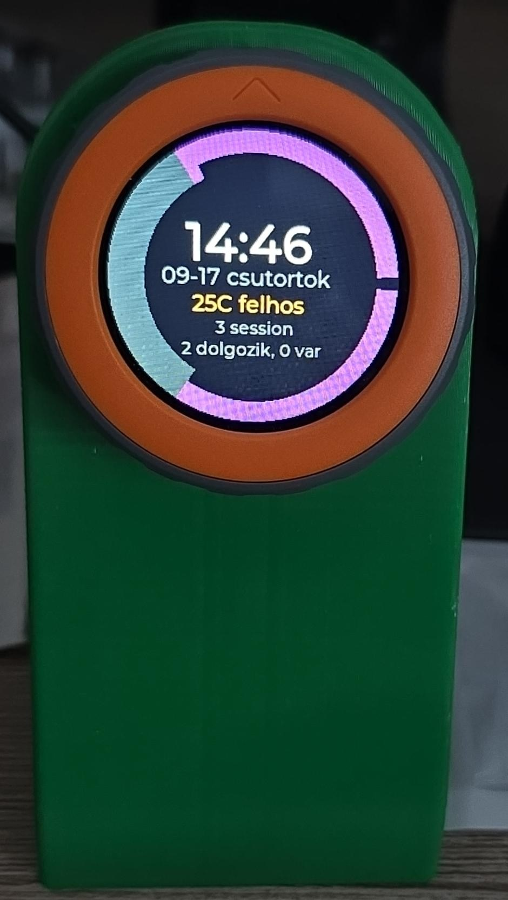
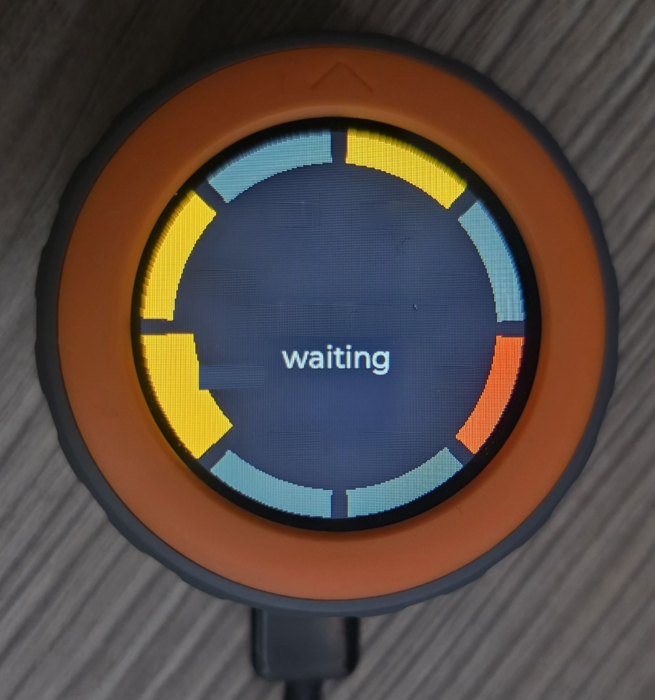
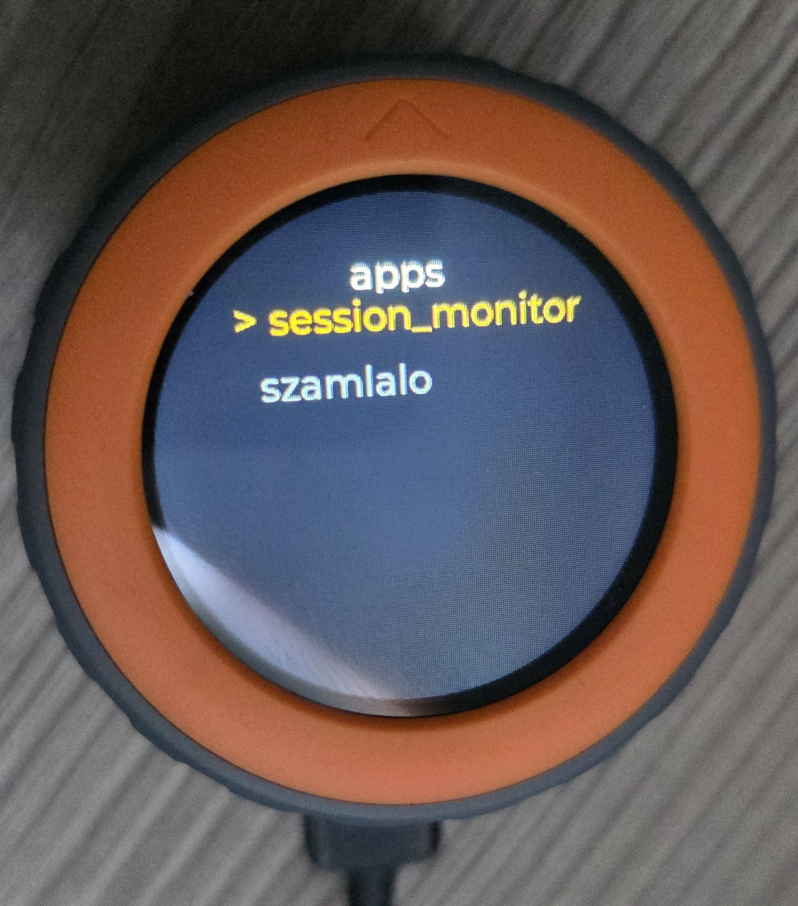
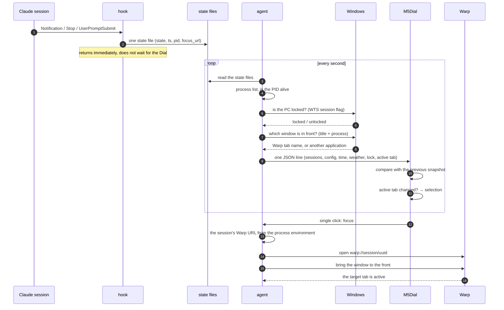
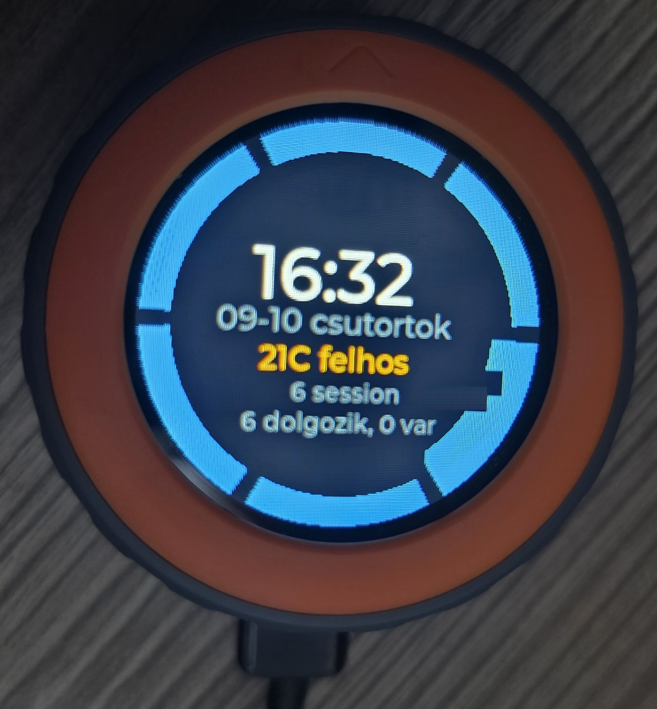
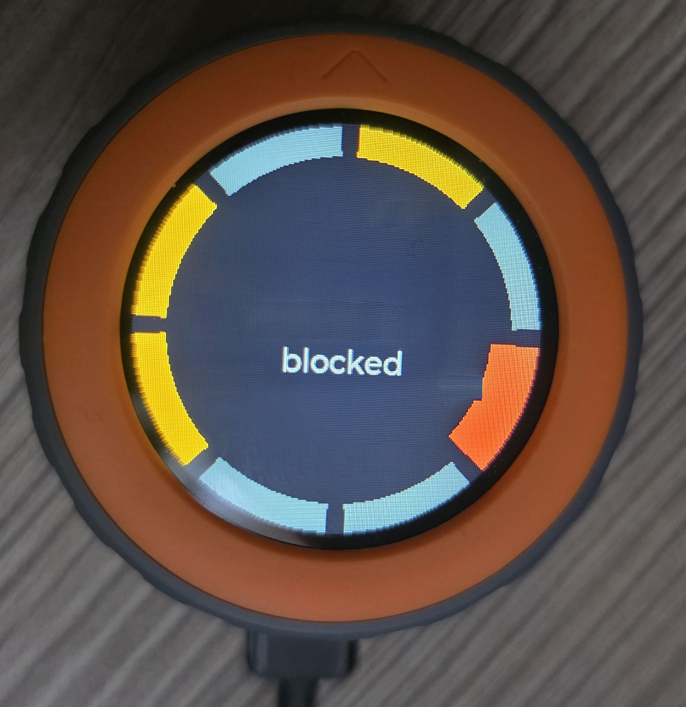

# M5Stack Dial · Claude session monitor


_Eight parallel sessions on one ring. The thicker segment is the selected one — here a
session that is currently working. Amber segments are the ones waiting for you. Under each
segment sits the session's short name, in its own color._

## 1. What is it?

A physical desk notifier for the **Claude Code sessions** running on your PC. At a glance
you see which session is working, which has finished, and which is **waiting for you**.
Click the selected session and the PC jumps to the matching Warp tab — no hunting for the
window it was running in.

The practical problem it solves: with 5-10 parallel sessions, notifications get lost and
it is hard to find which terminal is waiting for an answer.

When you **lock the PC**, the Dial locks too: all work information disappears and only the
clock, date and weather remain. A device left on the desk does not reveal what you are
working on or how many sessions are waiting for you.

## 2. The hardware

**M5Stack Dial v1.1** — a palm-sized device with a rotary head.
Official description: <https://docs.m5stack.com/en/core/M5Dial%20V1.1>

- **ESP32-S3-FN8**, 8 MB flash, no PSRAM
- **1.28" round 240×240 IPS display** with capacitive touch
- a **rotary knob (encoder)** and a **push button** under the head
- built-in **RFID reader**, **RTC**, buzzer, `PORT.A/B/C` connectors
- **USB-C** carries both power and data — no other cable needed

What matters for this project: the round display offers **a ring** that shows as many
sessions as fit, and the encoder gives a **natural way to choose** — neither would feel as
natural on a rectangular display or with a mouse.

The project runs on the **UIFlow2 firmware** (MicroPython), not Arduino, and does not use
the cloud web IDE: the code is written on the PC and uploaded with `mpremote`.

### Desk stand

The Dial sits in a **3D-printed stand**, display facing you, so it is readable at a glance
on the desk. In a stand, though, pressing the display tips the device over — that is why
tab jumping also has a variant that needs no gesture (a 2 s dwell, see below).

The model comes from MakerWorld
([M5Stack Dial Rotary Knob Stand](https://makerworld.com/hu/models/763395-m5stack-dial-rotary-knob-stand#profileId-782177)),
and printing it through [3dkraft.hu](https://3dkraft.hu/) cost roughly 3,500 HUF.



_In the stand, showing the idle panel: clock, date, weather and a summary. The two purple
segments are sessions waiting for their sub-agents — that is why they count as "working"
and not "waiting"._

## 3. How do you use it?

### On the device

| Gesture | What it does |
|---|---|
| **Rotate** | moves the selection between sessions |
| _(no gesture)_ | switching to another Warp tab on the PC makes the selection jump to it (see: Following the active tab) |
| **Rotate, then wait 2 s** | the PC jumps to the selected session's Warp tab — no press needed |
| **Single click** | the PC jumps to the session's Warp tab (~0.4 s delay) |
| **Double click** | mutes / unmutes the session (`*` next to the name) |
| **Long press** | back to the app list (the launcher's hardware gesture) |
| **Touch** | global volume: mute → low → medium → loud |

The single click is delayed by the double-click window because until then it is unknown
whether it is the first half of a pair. It could not work the other way round: a double
click would first jump to the tab and only then mute.

**The 2 s dwell** (`DWELL_FOCUS_MS = 2000`) sends the same `focus` request as a single
click, but it is armed only after rotation: if the selection does not move for 2 seconds,
Warp switches there. A selection that comes from a tab switch (tab following) does not arm
it — otherwise the Dial would drag the PC back to where it came from.

**On a locked PC no gesture works.** The app still reads rotation and clicks, but discards
them — it has to read them, otherwise the encoder would accumulate steps and the selection
would jump far on unlock.



_Live data: a session is waiting for an answer. This is the moment the whole thing was
built for — one glance at the desk and you know which terminal to go to._

### On the PC

```powershell
# start the agent by hand (normally the SessionStart hook starts it)
cd tools; python -m session_agent

# mute and volume from the PC side
.\tools\session-agent.ps1 -Mute
.\tools\session-agent.ps1 -Unmute
.\tools\session-agent.ps1 -Volume 2      # 0=mute 1=low 2=medium 3=loud

# quit the app running on the Dial (returns to the launcher)
.\tools\session-agent.ps1 -Quit

# start an app REMOTELY, without touching the device
.\tools\push.ps1 -Apps                       # what is on the device
.\tools\push.ps1 -Launch session_monitor     # start this one
```

Sound is **off by default** — the display notifies on its own, and beeping is annoying
with parallel sessions. An `-Unmute` or a touch turns it on.



_The launcher: a long button press brings it up, you choose by rotating, a click starts
the app. The device does not run just one program._

## 4. Setting it up on your own machine

Roughly a quarter of an hour, and nothing in it is irreversible.

### 1. What you need

- an **M5Stack Dial v1.1** and a USB-C cable,
- **Python 3.12** on the PC,
- the **Warp** terminal — everything works without it except jumping to the tab.

```powershell
pip install mpremote pyserial esptool
```

### 2. Firmware, if it is not on the device yet

Plug it in and see what shows up:

```powershell
.\tools\push.ps1 -List
```

- `303a:81dd` → **UIFlow2 is running, skip this step**.
- `303a:1001` → the factory Arduino firmware is on it and has to be replaced.
- no port → it is not plugged in, or the cable is charge-only.

Writing the firmware **overwrites whatever is on the device** — that is why it is a
separate step:

```powershell
esptool --chip esp32s3 --port COM3 write-flash 0x0 uiflow-v2.5.2-dial.bin
```

Afterwards the port number **may change** (for us COM3 → COM4), because the device
re-enumerates on native USB. Don't hard-code the port number anywhere.

### 3. Uploading the program

The launcher goes on as `main.py` (this is what starts at power-up), and the app goes into
the `apps/` folder. The shared modules go to the root:

```powershell
mpremote connect COM4 fs cp src\launcher.py :main.py
mpremote connect COM4 fs mkdir :apps
mpremote connect COM4 fs cp src\apps\session_monitor.py :apps/session_monitor.py
mpremote connect COM4 fs cp src\applist.py :applist.py
mpremote connect COM4 fs cp tools\session_agent\protocol.py :protocol.py
mpremote connect COM4 fs cp tools\session_agent\alerts.py :alerts.py
mpremote connect COM4 fs cp tools\session_agent\panel.py :panel.py
mpremote connect COM4 reset
```

`protocol.py`, `alerts.py` and `panel.py` are **the same files** that run on the PC —
that is why they contain no f-strings or type annotations.

### 4. Wiring up the hooks

This step writes `~/.claude/settings.json`, which **affects all your sessions** — make a
copy first. You need eight entries; each calls one of the same two scripts, using the
repo's **absolute** path:

| Event | Matcher | Script |
|---|---|---|
| `UserPromptSubmit` | — | `tools/hooks/session_status_hook.py` |
| `Stop` | — | `tools/hooks/session_status_hook.py` |
| `SessionEnd` | — | `tools/hooks/session_status_hook.py` |
| `Notification` | `idle_prompt` | `tools/hooks/session_status_hook.py` |
| `PermissionRequest` | — | `tools/hooks/session_status_hook.py` |
| `SubagentStart` | — | `tools/hooks/session_status_hook.py` |
| `SubagentStop` | — | `tools/hooks/session_status_hook.py` |
| `SessionStart` | `startup\|resume\|clear` | `tools/hooks/agent_supervisor.py` |

One entry looks like this:

```json
{
  "matcher": "idle_prompt",
  "hooks": [{
    "type": "command",
    "command": "\"C:/.../python.exe\" \"<repo>/tools/hooks/session_status_hook.py\""
  }]
}
```

The first seven hooks **write a state file**; the eighth **starts the agent** if it is not
already running. If the repo moves, the paths go stale and the system falls **silently**
quiet — there is no warning.

### 5. Starting up

Open a new Claude Code session: the `SessionStart` hook starts the agent. You can also do
it by hand:

```powershell
cd tools; python -m session_agent
```

On the device, start `session_monitor` from the launcher — or from the PC:

```powershell
.\tools\push.ps1 -Launch session_monitor
```

**Check:** the Dial should show the ring, with one segment per session. If it stays on
`nincs kapcsolat` (no connection), the agent is not running or cannot find the port.

### Further customization

- **Weather**: Open-Meteo by default, no key needed; the coordinates are in
  `session_agent/weather.py`.
- **Sound**: muted by default (`session-agent.ps1 -Unmute` turns it on).
- **Not using Warp**: tab jumping is skipped, everything else works.
- **When the screen counts as "asleep"**: the `M5DIAL_LOCK_IDLE_S` environment variable
  (seconds, default 600). With `0` the idle detection is off and only a real lock or the
  screensaver counts.

## 5. How does it work?

Three parts: a **hook** writes a state file on every Claude session event, the **agent**
merges those files with the process list every second and sends one JSON line over the
serial port, and the **Dial** draws and receives. In the same cycle the agent also checks
whether **the PC is locked** and puts the answer into the snapshot.

The hook deliberately does not talk to the device: it runs synchronously, so every
session's speed would depend on the Dial. Writing the state file takes milliseconds and
never blocks.



### States and colors

The logic is a traffic light, **from the user's point of view** — not the machine's:

| Color | State | Meaning |
|---|---|---|
| blue | `busy` | working, nothing for you to do |
| purple | `agents` | its turn is over, but sub-agents are still running — not waiting for you |
| green | `idle` | just finished its turn |
| amber | `waiting` | **waiting for you** |
| red | `blocked` | waiting for a permission, stuck |
| dark gray | `unknown` | no hook event yet |

The first version painted `busy` green ("working, so good"), but that is misleading: green
instinctively means *done*.



_When nobody is waiting for you: clock, date, weather and a summary, while the ring keeps
living in the background. In this view the segment labels hide so they don't overlap the
text._

### Locked PC

When Windows is locked, the Dial switches to the `locked` view: **clock, date and weather**
in the middle, **no** ring, session name or summary, at reduced brightness. Input is
ignored while locked.

Three things count as locked:

| Signal | What it covers |
|---|---|
| WTS session flag | Win+L, user switch, RDP disconnect |
| `SPI_GETSCREENSAVERRUNNING` | the screensaver is running |
| `GetLastInputInfo` idle time | monitor off / sleep — **an approximation** |

The third is an approximation because a real event would need a windowed power
notification (`GUID_CONSOLE_DISPLAY_STATE`), and the agent has no message loop. By default
it locks after 600 seconds of inactivity; adjustable with `M5DIAL_LOCK_IDLE_S`.

**The PC makes the decision, the Dial only carries it out** — only the PC can see the
Windows lock state. Without a connection we do not trust the signal: the last `lk` value
would be stale, so the `nincs kapcsolat` (no connection) view appears instead, which shows
only the clock and weather anyway.

**What did NOT work:** the first version used `OpenInputDesktop` (on a locked PC the call
fails with access denied). On Windows 10/11 this **flickers**: `LockApp` draws the lock
screen on the **Default** desktop, and the Winlogon secure desktop is in front only at the
moment of the switch — so the call succeeds again a second later. In live use the Dial
switched to the locked view for half a second, then went back to the ring while the PC was
still locked. Measured over one Win+L → fingerprint unlock cycle:

```
10:15:14  desktop_open=False  desktop=err5     flags=0  LogonUI=1   <- lock
10:15:15  desktop_open=True   desktop=Default  flags=0  LogonUI=1   <- FAILS HERE
10:15:19  desktop_open=False  desktop=err5     flags=0  LogonUI=1
10:15:21  desktop_open=True   desktop=Default  flags=1  LogonUI=0   <- unlock
```

`SessionFlags` stayed `0` (locked) throughout the same cycle, with no flicker.



_Live data: a session is waiting for a permission (red). In the middle you can always read
the selected session's name and state._

Green **turns amber by itself after 45 seconds**. At the moment of the `Stop` event the
session is already waiting for you, but the `Notification`/`idle_prompt` — which would say
so — arrives much later or not at all; in live use one session sat green for 110 seconds
while waiting for input.

**Sub-agents.** When a session launches (especially background) sub-agents, its turn ends
and `Stop` fires — but the session is not waiting for you, it is waiting for its
sub-agents. So the `SubagentStart`/`SubagentStop` hook records the running sub-agents in
the state file (the `agents` field) without overwriting the main state. While at least one
is running, an `idle`/`waiting` session is **purple** (`agents`), does not turn amber, and
does not sound the beep. A sub-agent started more than 30 minutes ago does not count (in
case its `SubagentStop` was lost); the 45 seconds then start from the end (or expiry) of
the last sub-agent. Blue is not suitable here because it already belongs to `busy`.

### Following the active tab

The link works both ways for the selection too: if you **switch to another Warp tab** on
the PC, the Dial's selection jumps to it. The other direction — a click and the 2 s dwell
taking you to the Dial's selected session's tab — already existed.

**The source is the title of the foreground window.** Every cycle the agent queries it
(`GetForegroundWindow` + `GetWindowTextW`), and if the window belongs to a Warp process, it
strips the state glyph from the title (`◐ cc-DashTiles` → `cc-DashTiles`) and compares it
with the session names. If **exactly one** session's name matches, its id goes into the
snapshot's `act` field; otherwise the field is omitted:

```
{"t":"s","seq":41,...,"sessions":[{"id":"2cd028e8","n":"cc-m5stack-dialv1.1","st":"idle"}],"act":"2cd028e8"}
```

**The Dial reacts only to a change.** If it applied `act` on every snapshot, it would reset
your rotation every second while Warp stays on the same tab. Hence:

| Situation | What happens |
|---|---|
| `act` differs from the previous received value | the selection jumps there |
| same `act` | nothing — your rotation stays |
| no `act` (another window is in front) | nothing, and the last value is **kept** — Alt-Tab back and forth to the same tab does not yank the selection |
| you rotated within the last 3 s | the change is **dropped** (not deferred): you are choosing right now, and the dwell aligns the tab to the Dial anyway |
| the session is not shown on the ring | nothing |
| locked PC | `act` is ignored |

Following does **not** beep, does not arm the dwell, does not send `focus`, and does not
count as input (it does not bring up the session view) — only the ring and the center name
update.

**Limitations:**

- **Tabs with the same name:** if two sessions have the same name, the title does not say
  which one it is — there is no following.
- **Split panes:** the title belongs to the tab, not the pane; a pane change within one tab
  is invisible.
- **Only when Warp is in front.** With another application in front the title is theirs,
  and there is no `act`.

**What did NOT work (measured, 2026-09-17):** the `active_tab_index` field in `warp.sqlite`
**lags by minutes** behind the real tab switch, and UI Automation exposes **nothing** about
the Warp window. The window title, by contrast, follows the active tab instantly.

## 6. Technical details

### The tab jump

`claude.exe` has no window (`MainWindowHandle = 0`), and the `pwsh.exe` processes of the
Warp panes are only 0×0 `PseudoConsoleWindow`s that are not children of the Warp window —
`SetForegroundWindow` on them does not switch tabs.

The solution is Warp's own focus URL. [warpdotdev/warp#8611](https://github.com/warpdotdev/warp/issues/8611)
was closed by the merged [PR #11130](https://github.com/warpdotdev/warp/pull/11130) on
2026-05-22, and since then every pane has it in its environment:

```
WARP_TERMINAL_SESSION_UUID  f96028319afc4f178bebc90a25841f1b
WARP_FOCUS_URL              warp://session/f96028319afc4f178bebc90a25841f1b
```

The URL is taken **primarily from the process's own environment**
(`NtQueryInformationProcess` + `ReadProcessMemory`, read-only), and only secondarily from
the state file: that one is deleted after 15 minutes as an orphan, and a reopened session
already sits in a different pane.

The URL switches the tab but **does not bring the window forward** — a background
process's `ShellExecute` may not steal focus. After the switch, the title of the window
containing the target pane is exactly the session's name; that tells which window to bring
to the front.

### Drawing the ring

M5GFX (`M5.Lcd.fillArc`), not LVGL. Measured on the device, for 8 segments:

| Operation | LVGL (`m5ui.M5Arc`) | M5GFX (`fillArc`) |
|---|---|---|
| build | 7782 ms | 25 ms |
| recolor all | 690 ms | 26 ms |
| recolor one segment | ~86 ms | 5 ms |
| memory | 3952 bytes | 80 bytes |

690 ms does not fit into a one-second cycle; 26 ms does.

### Non-obvious decisions

- **The hook does not talk to the device** (design 3.1) — otherwise every session's speed
  would depend on the Dial.
- **The Dial decides about sound**, not the agent: so restarting the agent does not cause
  false alerts, and per-session muting lives where it is managed.
- **`push.ps1` asks the agent to release the port** before uploading; if the marker file
  gets stuck, the agent reconnects by itself after 60 seconds.
- **The agent exits after 15 minutes without sessions**, and the next session's
  `SessionStart` hook starts it again — no orphan processes.

## 7. Tech stack

- **Device**: M5Stack Dial v1.1 (ESP32-S3-FN8, 8 MB flash, no PSRAM)
- **Firmware**: UIFlow2 v2.5.2 (MicroPython 1.27.0, M5Unified/M5GFX)
- **Drawing**: M5GFX (`M5.Lcd.fillArc`) + `Widgets` — not LVGL
- **PC**: Python 3.12 (`pyserial`), PowerShell 7 launchers
- **Integration**: Claude Code hooks (`Notification`, `PermissionRequest`,
  `UserPromptSubmit`, `Stop`, `SessionEnd`, `SubagentStart`, `SubagentStop`)
- **Transport**: USB CDC serial, one JSON per line, bidirectional
- **Terminal**: Warp (the focus URL comes from it)
- **Tests**: 456 unit tests for the pure logic (`python -m unittest discover -s tests`)
