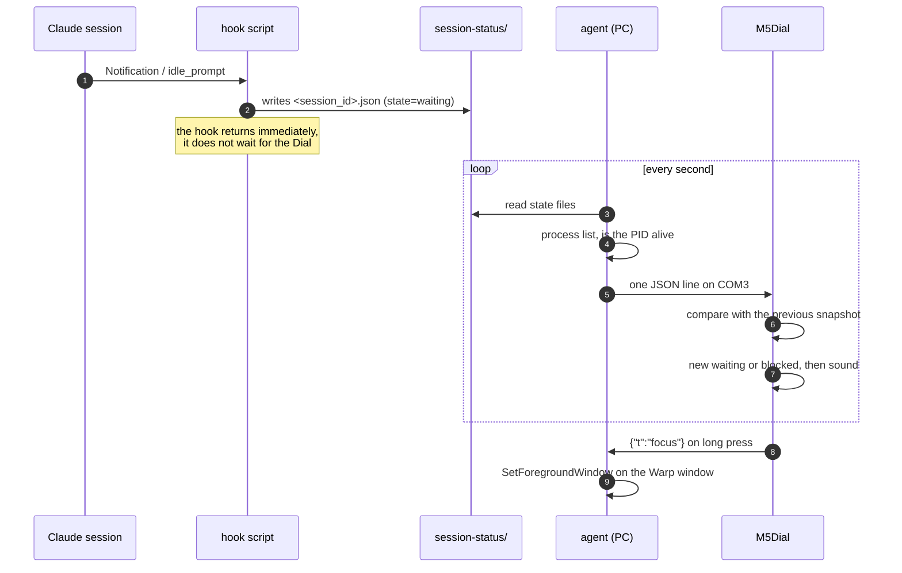

# M5Dial Claude session notifier — design

*2026-09-09 · status: approved design · **2026-09-10: the two open measurements
were done; 4.3 and 4.8 rewritten according to the results***

## 1. What is this?

A physical notifier on the M5Stack Dial for the **Claude Code sessions** running on
the PC. The round display shows at a glance which session is working, which one
has finished, and which one is **waiting for the user** — the latter is also
signalled by sound.

The pain it addresses is real and recurring: the user routinely works in 5-10
parallel sessions (at measurement time: **7 named `claude.exe` sessions** at once),
all of them tabs of a single Warp window. There is no at-a-glance answer to "which
one is waiting for me?".

## 2. How is it used?

The Dial is connected to the PC over USB and continuously shows the session ring.

| Action | Effect |
|---|---|
| Rotate | steps the selection between sessions |
| Short button press | acknowledge/mute the selected session |
| Long button press | back to the app list (global gesture of the launcher) |
| Touch the screen | steps the volume: mute → low → medium → loud |

**The meaning of the long press changed on 2026-09-10.** It was originally meant to
bring the Warp window to the foreground, which fell through for two reasons:

1. **Measured (2026-09-09):** the `MainWindowHandle` of every `claude.exe` is `0`
   and there is a single Warp window — there is no per-session window to bring to
   the front, so the action could not do what it was invented for.
2. The long press has meanwhile become the **launcher's global "back" gesture**: a
   hardware-level watchdog reads GPIO42. Apps cannot take it away.

The protocol's `{"t":"focus"}` message is therefore **unused for now**; it stays in
the protocol because it is cheap, and can be bound to a working PC-side action if
one ever exists.

Starting the PC-side agent:

```powershell
.\tools\session-agent.ps1 -Port COM3          # foreground, with log
.\tools\session-agent.ps1 -Port COM3 -Quiet   # quiet
```

Sound on/off and volume from the PC, also while the agent is running:

```powershell
.\tools\session-agent.ps1 -Mute
.\tools\session-agent.ps1 -Unmute
.\tools\session-agent.ps1 -Volume 2           # 0=mute, 1=low, 2=medium, 3=loud
```

Uploading code while the agent runs (the port is released automatically):

```powershell
.\tools\push.ps1 -Deploy
```

## 3. How does it work?



### 3.1 Why doesn't the hook talk to the Dial directly?

Because then **every session's speed would depend on the Dial**. The hook runs
synchronously; if the board is unplugged or not answering, the session would stall.
Writing a state file takes milliseconds and never blocks — whether the Dial is
reachable is the agent's problem.

### 3.2 Resolving the COM port conflict

The price of USB serial transport is that the agent holds COM3, so the `push.ps1`
dev loop could not use it. Resolved with a marker file:

1. `push.ps1` creates the `~/.claude/session-status/.release` file.
2. The agent notices it (within 1 s at most), closes the port and waits.
3. `push.ps1` does the upload/run.
4. `push.ps1` deletes the marker file; the agent reconnects.

If `push.ps1` crashes and the marker stays behind, the agent **reconnects by itself
after 60 s** — a stuck marker file cannot leave the system silently dead.

## 4. Technical details

### 4.1 Components

| Component | Where | Responsibility |
|---|---|---|
| hook scripts | `~/.claude/hooks/session-status/` | find the session's PID up the parent chain, then write a single state file — nothing else |
| agent | `tools/session-agent.ps1` (+ Python core) | merging, serial I/O, PC-side actions |
| Dial program | `src/apps/session_monitor.py` | protocol, drawing, sound, input |
| shared modules | `protocol.py`, `alerts.py` on `/flash` | the same code runs on the PC and on the device |
| `push.ps1` | existing, extended | requests port release before uploading |

### 4.2 States and their source

All five hook events come from **measurement** (the `claude-code-warp` plugin's
`hooks.json` already uses them), not from assumption:

| Hook event | State | Meaning |
|---|---|---|
| `Notification`, matcher `idle_prompt` | `waiting` | waiting for you |
| `PermissionRequest` | `blocked` | waiting for permission |
| `UserPromptSubmit` | `busy` | working |
| `Stop` | `idle` | finished its turn |
| `SessionEnd` | *(delete the file)* | over |

The state file:

```json
{"state": "waiting", "ts": 1757421000, "pid": 96624,
 "cwd": "C:\\proj\\demo"}
```

**The `pid` field was added on 2026-09-10, as a result of a measurement.** The
original design meant `cwd` to be the join key between the process and the state
file, but that would never have matched: Windows **does not expose another
process's working directory** (`Get-CimInstance Win32_Process` has no such field),
so the process-side `cwd` is always `None`. Consequently every session would have
been `unknown`, and every state file would have counted as stale — that is,
deleted.

The solution: **the hook writes its own session PID into the file.** Walking up its
parent chain, the hook finds the `claude.exe`. This works, measured — from a
grandchild process, four levels up, there was the
`claude.exe --name cc-m5stack-dialv1.1`, exactly the session the test was started
from.

`cwd` stays, in two roles: the fallback for the displayed name when `--name` is
missing (4.3), and a fallback join key when a state file has no `pid`.

The hook receives its payload on stdin as JSON. The two fields the state file above
needs are **verified** (from the `BaseHookInput`/`NotificationHookInput` types in
the installed Claude Agent SDK's `claude_agent_sdk/types.py`, and from the `warp`
plugin's scripts, which read exactly these with `jq`):

| Field | What it is for |
|---|---|
| `session_id` | the state file's name, and the session's identifier in the protocol |
| `cwd` | the working directory — gives the fallback name when there is no `--name` |
| `hook_event_name` | which event fired |
| `notification_type` | for a `Notification` event this carries `idle_prompt` |
| `message`, `title` | human text; does not fit on the Dial, but worth logging |
| `transcript_path`, `permission_mode` | unused for now |

### 4.3 Which sessions are shown

**Measured on 2026-09-10 — the mystery of the nameless `claude.exe` processes is
solved, and the filter rule changed as a result.**

The nameless ones **are not sessions, and not the CLI**: they are processes of the
**Claude Desktop Electron application**, from an entirely different binary
(`AppData\Local\AnthropicClaude\app-*\claude.exe`), while the real sessions run from
`~\.local\bin\claude.exe`. Of the 8 nameless ones, one is the Electron main
process; the rest are its usual children (`--type=renderer`, `--type=gpu-process`,
`--type=utility`, `--type=crashpad-handler`), all children of the main process.

The 7 named ones, by contrast, all run from the same CLI binary, are all **direct
children** of a `pwsh.exe` in Warp, and all carry `--remote-control <name>`.

It follows that **filtering on `--name` would work for the wrong reason**: it does
not separate sessions from background processes, it just happens to exclude a
different product whose binary is also called `claude.exe`. If a real session were
ever started without `--name`, it would be silently invisible.

**The rule is therefore:**

1. the process's **executable path** is the CLI binary (`~\.local\bin\claude.exe`),
   **and**
2. its **parent is a shell** (`pwsh.exe`, `powershell.exe`, `cmd.exe`, `bash.exe`,
   `WindowsTerminal.exe`), **not** another `claude.exe`.

`--name` is still needed, but **only as a display label**; if missing, the last
component of `cwd` or the session id is the fallback — the session cannot vanish
from the ring either way.

**What the measurement could not show:** at measurement time no `claude.exe` child
was running, so the "child of a `claude.exe` = subagent" assumption is still an
expectation, not an observation. Rule 2 is correct regardless, because it is a
positive condition (the parent shell), not a negative one.

Merge rules:

| Process alive | State file | Result |
|---|---|---|
| yes | present (`pid` matches) | the state file's state |
| yes | absent | `unknown` (no hook event yet) |
| no | present, with `pid` | stale — not shown, the file is deleted |
| — | present, without `pid` | **orphan**: shown with its own state while fresh |

**The orphan case was added on 2026-09-10**, because the strict "no process →
stale" rule had a silent loss: if the hook cannot resolve the session PID, the
state file cannot be tied to a process, and the session would have **vanished from
the ring** — in the worst case a `waiting` one, exactly what the whole device is
built for.

An unjoinable state file is therefore **not stale but an orphan**: the state in it
is real information, written by a real hook, we just cannot tie it to a process. It
is shown, named after the last component of `cwd`.

So that a dead orphan does not stay on the ring forever, it expires: based on `ts`
it becomes stale after **15 minutes**. A missing or uninterpretable `ts` counts as
expired — a malformed file must not be able to stick forever.

Importantly, this **does not loosen** the normal death path: a state file with a
`pid` whose process is no longer alive is stale immediately, however fresh its `ts`.

### 4.4 Protocol

One JSON object per line, terminated by `\n`, UTF-8.

**PC → Dial** (every second, even when unchanged — this doubles as the heartbeat):

```json
{"t":"s","seq":41,"cfg":{"mute":false,"volume":2},
 "sessions":[{"id":"2cd028e8","n":"cc-m5stack-dialv1.1","st":"waiting"}]}
```

**Dial → PC** (on an event):

```json
{"t":"ack","id":"2cd028e8"}
{"t":"focus"}
{"t":"vol","v":2}
```

If the Dial receives no line for **5 s**, it shows a "no connection" screen. This
covers a pulled cable, a stopped agent and the port release for `push.ps1`.

### 4.5 Sound rule

The sound is **decided on the Dial**, not on the agent: the Dial compares every
snapshot with the previous one and sounds when a session **enters `waiting` or
`blocked`**.

It lives there so that restarting the agent does not cause false alarms, and the
per-session mute state is kept on the Dial, where it is handled. Rules that go with
it:

- **The first snapshot after connecting is silent** — otherwise every start would
  bring a flood of alerts.
- A per-session mute lapses by itself at that session's next state change.
- **A short press is a toggle, not a one-way flag** (2026-09-10, user feedback on
  the board): pressing again undoes the mute. The displayed `*` used to stay on the
  name until a state change cleared it, which was misleading — whoever muted
  something wants to be able to undo it. The `{"t":"ack"}` message therefore also
  carries an `m` field: `1` = muted, `0` = unmuted.

### 4.6 Global mute and volume

Above the per-session acknowledgement there is a **global switch** that turns the
sound off completely when it is annoying.

The source of truth is on the **agent side**: `~/.claude/session-status/config.json`.

```json
{"mute": false, "volume": 2}
```

Four levels, cycled round and round: `0` = mute, `1` = low, `2` = medium,
`3` = loud. The mapping to `M5.Speaker.setVolume()`: `0 → 0`, `1 → 48`, `2 → 128`,
`3 → 255`. `mute: true` suppresses every sound regardless of the volume.

It can be set from two places, and **both end up in the same file**:

- **From the PC**: `session-agent.ps1 -Mute` / `-Unmute` / `-Volume <0..3>` — writes
  the file, the agent picks it up by watching the mtime. Works while the agent is
  running.
- **From the Dial**: touching the screen steps the level; the Dial sends a
  `{"t":"vol","v":N}` message and the agent saves it to the config.

The config is included in every snapshot, so the Dial's and the PC's state cannot
drift apart: the Dial always shows what is in the file.

If the config file is missing or corrupt, the agent starts with the defaults
(`mute: false`, `volume: 2`) and rewrites it — a broken file cannot silently mute
the system.

### 4.7 Two critical MicroPython details

- **`micropython.kbd_intr(-1)`** at the start of the program. Without it a `0x03`
  byte in the data stream raises `KeyboardInterrupt` and kills the program.
- Read `sys.stdin` with **`uselect.poll()`, non-blocking**, otherwise drawing and
  button handling stop until data arrives.

### 4.8 Display

Round 240×240, so the content is built around the (120,120) centre:

- **A segmented ring on the edge**, one segment per session, coloured by state:
  red = `blocked`, amber = `waiting`, **blue = `busy`, green = `idle`**, dark grey =
  `unknown`.

  **The colours of `busy` and `idle` were swapped on 2026-09-10**, on user
  feedback. `busy` was originally green ("it is working, so fine"), but green
  involuntarily means *done*. The right reading is the user's point of view, not
  the machine's: **green = nothing for you to do**, amber = waiting for you, red =
  stuck. A working session is therefore blue (in progress).
- **In the centre**, the name and state of the selected session.
- The selected segment is thicker.

**The layer: M5GFX (`M5.Lcd.fillArc`) + `Widgets` — not `m5ui`/LVGL.** This reverses
the design's original decision, justified by measurement.

On 2026-09-10 both routes were built with the same geometry and the same
measurements (`src/apps/spike_gyuru.py` = LVGL, `src/apps/spike_gyuru2.py` =
M5GFX), and run live on the board:

| Operation | `m5ui.M5Arc` (LVGL) | `M5.Lcd.fillArc` (M5GFX) |
|---|---|---|
| Build/draw 8 segments | 7782 ms | **25 ms** |
| 16 segments | 25957 ms | **43 ms** |
| Recolour all 8 segments | 690 ms | **26 ms** |
| Recolour one segment | ~86 ms | **5 ms** |
| Step the selection | 3 ms | 14 ms |
| Memory | 3952 bytes | **80 bytes** |

The deciding number is the cost of the **once-per-second refresh**: on LVGL one full
recolour is 690 ms — two thirds of a second in a single operation. On M5GFX it is
26 ms. The start-up difference of 7.8 s vs. 25 ms is just as clear.

LVGL's slowness does not come from the number of segments but from every segment
being a **full-screen, stacked** `M5Arc` object, and every style change
redrawing all of them.

The user confirmed on the display that the M5GFX version looks right: 8 separate
segments with a visible gap, the selected one thicker, stepping on rotation.

**Consequence for the rest of the design:** since `Widgets`/M5GFX and `m5ui`
**cannot be mixed** on one screen, the centre text is also a `Widgets.Label`, not
an `m5ui.M5Label`.

**What this does not settle:** the measured `fillArc` times are for a static image.
Whether drawing still fits in the one-second loop alongside serial reception and
button handling must be re-measured at integration.

## 5. Testing

TDD where it makes sense:

- **Agent merge logic** — a pure function (state files + process list → snapshot).
  This is the most important part to test: every row of the 4.3 table is a test
  case, the stale session separately.
- **Protocol parser** — the Dial-side line handler also runs on desktop Python, so
  it is testable with a truncated line, bad JSON and an empty list.
- **Sound rule** — transition detection with snapshot pairs, including the "first
  frame is silent" and "mute lapses on state change" cases.
- **Global mute and volume** — `mute: true` suppresses at every level; the level
  stepping wraps round (`3 → 0`); a missing or corrupt config file yields the
  defaults, not a mute system.
- **What is not unit-testable** (drawing, real serial I/O, sound): manual check on
  the board, with the serial output recorded in the log.

## 6. Open questions and risks

1. **Wiring the hooks into the global `~/.claude/settings.json` needs separate
   permission** — that file affects every session. **Open.** At measurement time
   it holds `UserPromptSubmit`, `SessionStart`, `PostCompact`, `Stop` and
   `SessionEnd` hooks; `Notification` and `PermissionRequest` are **not** there —
   those come from the `warp` plugin through its own `hooks.json`.
2. ~~The role of the 10 nameless `claude.exe` processes is unclear (4.3).~~
   **Closed 2026-09-10** — they are Claude Desktop's Electron processes, see 4.3.
3. ~~The feasibility of the segmented ring is not measured (4.8).~~
   **Closed 2026-09-10** — measured, and the layer changed from LVGL to M5GFX, see
   4.8.
4. The `idle_prompt` matcher of the `Notification` hook is **confirmed, but not from
   a live payload**: the `warp` plugin's `on-notification.sh` actually reads the
   `.notification_type` field, and the installed Claude Agent SDK's
   (`claude_agent_sdk/types.py`) `NotificationHookInput` type describes the event
   the same way. **Nobody has seen a live, captured payload**, though — that would
   need a logging hook, which already changes state (see item 1). It is also open
   whether `notification_type` can take values other than `idle_prompt`: the SDK
   types it as a plain `str`.
5. Starting the agent automatically (at login) is not part of this round.

## 7. Tech stack

- **Device**: M5Stack Dial v1.1, UIFlow2 MicroPython, **M5GFX (`M5.Lcd`) +
  `Widgets`** — `m5ui`/LVGL dropped based on the 4.8 measurement
- **PC**: PowerShell 7 launcher + Python 3.12 core (`pyserial`)
- **Integration**: Claude Code hooks (`Notification`, `PermissionRequest`,
  `UserPromptSubmit`, `Stop`, `SessionEnd`)
- **Transport**: USB CDC serial, JSON per line, bidirectional
